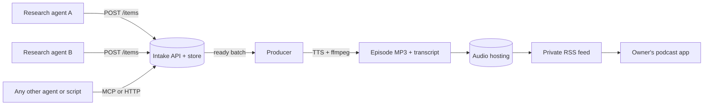

# Architecture

This file is for the agent that builds the system. It names the components, the contract each one must meet, and a pass-fail check for each. It does not pick a cloud, a language or a framework. Choose whatever the owner already uses, and record the choice in `settings`.

The research and editorial steps are in [GUIDE.md](GUIDE.md). This file covers what they run on.

## The shape

The intake API is the seam. Research and production never share a process, a file system or a model. Any agent that can make an HTTP request can contribute research, and the producer never has to know who found an item.

A single agent with one folder can stand in for the intake API while there is only one researcher. Build the API as soon as a second agent, a second machine or a script needs to contribute.

## Components

| # | Component | Required | Contract in short |
| --- | --- | --- | --- |
| C1 | Persistent store | yes | Survives restarts; holds items, batches, aired log, cost log, run log |
| C2 | Research intake API | yes once there are two contributors | Authenticated `POST /items`, typed responses, deterministic batching |
| C3 | Intake MCP server | optional | The same operations as C2, as tools |
| C4 | Scheduler | yes | Runs research and production on a cadence and logs every run |
| C5 | Secrets | yes | Every key lives outside the code and outside chat |
| C6 | Voice service (TTS) | yes | Renders narration with one saved voice, under a budget |
| C7 | Audio pipeline | yes | `ffmpeg` plus speech-to-text for clip alignment |
| C8 | Audio hosting | yes | Serves MP3s and transcripts at unguessable URLs |
| C9 | Private RSS feed | yes, the default delivery | A valid podcast feed the owner subscribes to once |

Each one below has its contract and its proof. Where GUIDE.md already specifies a component in full, this file points there instead of repeating it. A component is done only when its proof passes.

---

### C1. Persistent store

- Contract: state survives a restart of the agent, the machine and a redeploy. On one machine, use the folder layout in GUIDE A12. With an intake API, its items, batches, contributor keys (hashed) and transitions live in a real database (a managed Postgres or SQLite on a persistent disk), and migrations run from code.
- Pass-fail: GUIDE A12's restart check passes, and for the API, a row written before a redeploy reads back after it and rerunning migrations changes nothing.

### C2. Research intake API

The point of this component is that any agent can contribute research independently of the one that produces audio.

**Auth**

- Each contributor gets its own key. Store only a hash of it, and derive `submitted_by` from the key, never from the request body.
- A separate admin token can mint and revoke keys and move batches. Contributor keys can only submit.
- Revoking a key takes effect on the next request.

**`POST /items`**

The request body is one queue item, valid against [templates/queue-item.schema.json](templates/queue-item.schema.json). That schema is the only definition of the fields; this file never adds or renames one. An item that fails the schema returns `400` naming each bad field.

The responses are typed, so a contributor can act on them without reading prose:

| Status | Meaning | What the contributor does |
| --- | --- | --- |
| `201` | Accepted and pending | Nothing |
| `409` | Exact duplicate (same dedupe key or the same canonical source URL) | Nothing; don't retry |
| `202` | Near duplicate, merged into an earlier item as an extra take | Nothing |
| `400` | Invalid body; the message names each bad field | Fix and resubmit once |
| `401` | Missing or revoked key | Stop and report |
| `429` or `403` | Rate limit or edge protection | Stop the run, queue the rest locally, retry next run |

Rules the service enforces:

- Dedupe key, when the contributor didn't send one:
  - Story: the canonical `source_link`. Canonicalizing lowercases the host, drops a trailing slash, and removes only a fixed list of tracking parameters (`utm_*`, `fbclid`, `gclid`, `mc_cid`, `mc_eid`, `ref`). Every other parameter stays.
  - Clip: `episode_audio_url` plus the start time in whole seconds. Never strip a timestamp, so two clips from one episode never collide.
- Exact duplicate (`409`): the same dedupe key.
- Near duplicate (`202`), decided by a stated test with no model:
  - Story: published within 7 days of an earlier story, shares its source domain, and the lowercase headline tokens (stopwords dropped) have a Jaccard similarity of at least 0.8.
  - Clip: the same `episode_audio_url` as an earlier clip, with windows overlapping by more than half of the shorter one.
- A duplicate is never silently dropped. Its new facts, analysis and URLs attach to the original item as a take, and the take adds no airtime.
- No model call on the submit path. Same inputs, same decision.

**Batching**

The service, not any contributor, decides when there's enough for an episode.

- Estimate airtime deterministically. For example, narration seconds = words in `verified_facts` plus `why_it_matters` / 140 × 60, and a clip adds `end_time` minus `start_time`. An item whose `why_it_matters` is under a minimum word count in `settings` is marked thin and counts zero.
- When pending substantive airtime reaches the threshold in `settings` (for example 600 seconds), move those items into one `ready` batch.
- Batches have explicit states: `ready`, `claimed`, `built`, `failed`, `abandoned`. A producer claims a batch, then marks it built (with the episode URL) or failed (with a reason). Items in an abandoned batch can be released back to pending.
- Tell the producer by webhook, polling (`GET /batches?status=ready`), or both. A webhook carries a signed or keyed header, and the key is never logged.

**Docs**

- `GET /docs` returns the request shapes and a curl example for each kind, so a new contributor agent can onboard itself from the URL.
- Also publish an OpenAPI file. Many agent platforms can import one as a tool.

**Pass-fail**

- A valid story returns `201`, and the same body again returns `409`.
- A body missing a required field returns `400` naming that field.
- A revoked key returns `401`.
- Submitting items until the threshold is crossed returns exactly one `ready` batch, and running the same sequence against a fresh store gives the same batch.
- A second, unrelated agent can read `/docs`, submit an item and get `201` with no help from the owner.

### C3. Intake MCP server (optional)

- Contract: the same operations as C2 (submit item, list ready batches, claim, mark built or failed), exposed as MCP tools over HTTP. Each contributor's key goes in the server URL path or a header.
- Pass-fail: an MCP client lists the tools, submits one item and gets the same typed result as the HTTP call.

### C4. Scheduler

- Contract and proof: GUIDE A13 (research, then production, with a lock, finishing before the owner's listening time, and a `runs.log` row for every run, skipped ones included).

### C5. Secrets

- Contract and proof: GUIDE A11. This adds the intake admin token, one key per contributor, and the webhook key to the list, and the same rule applies to all of them: by name only, never in a repo, prompt, chat or log.

### C6. Voice service (TTS)

- Contract: one saved voice ID and model in `settings`. Chunk the script at section breaks under the provider's per-call limit, keep the request IDs for each chunk, and log characters or credits per episode against the monthly cap.
- Credentials: an API key from the owner's own TTS account, stored as in C5.
- Pass-fail: a 2–3 sentence test renders and plays end to end. The cost log has a row for the test, and an over-budget projection makes the build skip or shorten.

### C7. Audio pipeline

- Contract: `ffmpeg` for cutting, fades, crossfades and encoding (for example MP3, 128 kbps, 44.1 kHz). Whisper or another speech-to-text model for re-aligning clips. See GUIDE A4 and A5.
- Pass-fail: `ffmpeg -version` prints a version string, and a known clip re-aligns so that the quote's opening words fall within its first 5 seconds.

### C8. Audio hosting

- Contract and proof: GUIDE A9 (HTTPS, range requests, `audio/mpeg`, a random token of at least 128 bits in the path, no directory listing).

### C9. Private RSS feed (default delivery)

The episode should simply show up in the owner's podcast app with everything else they listen to. Chat delivery is the fallback, not the default.

- Contract and proof: GUIDE A9 (the feed fields, atomic publish, rotation, and the parse, `HEAD`, range and subscribe checks). After publishing, mark the intake batch `built` with the episode's `guid` (never its URL, which contains the secret token).

---

## Deploy order

1. C1 store, C5 secrets.
2. C2 intake API with docs; mint a key for each research agent.
3. C4 scheduler, writing to the run log.
4. C6 voice and C7 audio pipeline on the producer.
5. C8 hosting and C9 feed; subscribe in the owner's podcast app.
6. Point every research agent at `/docs` and give it its key.
7. Run [CHECKLIST.md](CHECKLIST.md) end to end.

## What not to prescribe

Leave the provider, language and framework to the builder. Hold every build to the contracts and proofs above. If a component's proof can't pass on the chosen platform, say which one and why, and fall back as GUIDE A1 describes.
